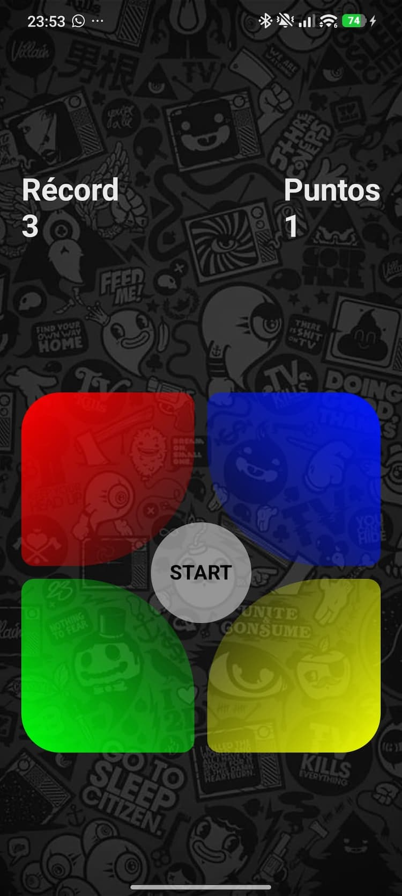

# Simon Says Classic 🎮🧠

## 📱 About the App

**Simon Says Classic** is a mobile application that brings the timeless memory game to your device. Test and improve your memory by repeating sequences of lights and sounds that become progressively more challenging.

Perfect for quick fun or for training your brain anytime, anywhere!

  

     
   

---

## 📑 Index

- [📱 About the App](#-about-the-app)
- [📥 Downloads](#-downloads)
- [🚀 Features](#-features)
- [🐛 Reporting Bugs & Feedback](#-reporting-bugs--feedback)

---

## 📥 Downloads

You can download the app here:

- [Download Simon Says 1.0.0](https://github.com/mesegr/Simon-says/releases/tag/v1.0.0)  

---

## 🚀 Features

✅ Classic memory game experience  
✅ Progressive difficulty as sequences grow  
✅ Minimalist and intuitive interface  
✅ Fun for all ages  

---

## 🐛 **Reporting Bugs & Feedback**  
Found a bug? Have suggestions?  
- Open an **Issue** on this repo.  

Please include:  
- **Description**: What happened?  
- **Steps to reproduce**: How can we trigger it?  
- **Screenshots/Videos** (if possible).  
